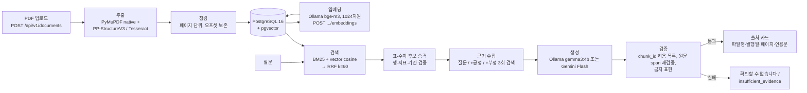

# Stock Brief AI 아키텍처

- 작성일: 2026-11-26
- 범위: 증권사 리포트 PDF를 근거 기반으로 검색하고 요약하는 독립형 RAG 포트폴리오
- 이 문서의 모든 수치는 [`docs/plans/rag-보강.md`](plans/rag-보강.md)의 단계별 `기록:`이나 기존 `docs/` 실행 기록에서 가져왔다. 수치마다 출처 단계를 괄호로 적었다.
- 투자 권유, 매수·매도 추천, 자동매매는 범위 밖이다.

## 1. 파이프라인

| 단계 | 위치 | 동작 |
|---|---|---|
| 수집 | `backend/app/service.py` `ingest_document` | `.pdf` 확장자, 50MB 제한, `%PDF-` 서명을 검사하고 SHA-256으로 중복을 막는다. |
| 추출 | `pdf_pipeline.extract_pdf`, `fused_extraction.extract_page` | PyMuPDF native 텍스트를 기본으로 쓴다. 복잡한 페이지는 별도 CPU worker의 PP-StructureV3로 구조를 분석한다. worker가 실패할 때만 Tesseract로 넘어간다. 표 fact와 출처(provenance)는 `page_extractions`에 저장한다. |
| 청킹 | `chunking.split_page`, `structured_spans` | 페이지 단위로 최대 1200자, overlap 없이 자른다. `final_text` 기준 `char_start/char_end`를 보존한다. fact-fusion 페이지는 승인된 구간만 청크로 만든다. |
| 임베딩 | `embedding_service.embed_document` | Ollama `bge-m3`(1024차원)를 쓰고 배치는 100개다. 임베딩 입력은 청크 본문과 표 fact 설명을 합친 `retrieval_text`다. |
| 검색 | `search.hybrid_search`, `rank_rows` | 필터된 청크로 요청마다 BM25를 만들고, pgvector cosine 결과와 RRF(k=60)로 합친다. 그 뒤 행·지표·기간이 검증된 표/수치 후보를 앞으로 올린다. |
| 생성·검증 | `analysis_service.analyze_document`, `evidence_facts.grounded_card` | 근거 packet으로 생성한다. 모델이 고른 chunk_id가 검색 후보에 있을 때만 citation으로 복원한다. 인용문은 모델이 쓰지 않고 원문 span에서 다시 가져온다. |

(구조는 플랜 0단계의 코드 확인 결과를 따른다. 2026-11-24 기준이다.)

## 2. 설계 결정

| 결정 | 이유 | 대가 |
|---|---|---|
| BM25 + vector를 RRF(k=60)로 합친다 | 한국어 금융 리포트에는 `2Q26`, `7,570억원` 같은 정확한 토큰이 많아 lexical 매칭이 강하다. 의미 질문은 vector가 낫다. 서로 다른 점수 척도를 순위만으로 합칠 수 있다. | 한쪽 순위가 낮으면 다른 쪽 1위가 희석된다(3·10단계 관찰). |
| 기본 검색 동작은 바꾸지 않고, 실험은 키워드 옵션으로만 추가한다 | dev 9케이스로 기본값을 바꾸면 과적합 위험이 크다. 옵션: `use_bm25`, `bm25_tokenizer`, `bm25_weight`, `split_page(overlap=)` | 개선 후보가 실제 서비스에 바로 반영되지 않는다. |
| 분석 경로는 vector를 exact scan으로 찾는다 | 코드 주석에 따르면 ARM 환경에서 pgvector HNSW 사용 중 backend 프로세스 종료가 관찰되었다. | 문서 수가 늘면 vector 검색 비용이 선형으로 커진다. |
| 임베딩은 로컬 Ollama `bge-m3`를 쓴다 | 다국어(한국어) 지원, 1024차원, 외부 API 키 없이 로컬에서 실행할 수 있다. | 임베딩 모델을 바꾸면 전체를 다시 임베딩해야 한다. 차원 변경 시 기존 벡터를 자동으로 바꾸지 않는다. |
| 검색 표현과 인용문을 분리한다 | 표 fact 설명을 붙인 `retrieval_text`로 검색 재현율을 높이고, 사용자에게는 원문 span만 보여 준다. | 검색 텍스트와 인용문이 달라 디버깅할 때 둘을 따로 봐야 한다. |
| fail-closed로 거절한다 | 근거가 검증되지 않으면 주장을 노출하지 않고 `확인할 수 없습니다` 또는 `insufficient_evidence`로 끝낸다. | 답할 수 있는 질문도 보류될 수 있다(sealed holdout v1에서 15문항 모두 HOLD, 아래 4절). |
| 표 fact를 요청마다 다시 검증한다 | 저장된 fact를 그대로 믿지 않고 provenance에서 다시 유도해 검증한다(`verification_cache`는 요청 단위). | 청크가 많은 문서에서 지연이 크다(아래 3.4절). |
| dev/test를 분리하고 gold는 사람이 승인한다 | 튜닝에 쓴 질문으로 성능을 주장하지 않는다. 정답 근거는 사람이 PDF 원문과 대조해 승인한 것만 쓰고, 봉인한 뒤에는 고치지 않는다. | 평가셋이 작다(dev 9케이스, test 13케이스). |
| 질문을 유형별로 나눠 본다 | 정확 수치·기간 질문과 의미 풀이 질문은 잘 맞는 검색 방식이 다르다. | 유형별 분모가 4~7이라 한 케이스가 비율을 크게 움직인다. |

## 3. 평가

### 3.1 평가셋

| 셋 | 내용 | 용도 | 출처 |
|---|---|---|---|
| dev | `evals/audit-cases.json` + `evals/pinned-gold.json`. 4문서, 답 있는 9케이스 / 12단위(exact 5, semantic 4) | 튜닝 허용 | 1·9단계 |
| test-v2 | `evals/test-v2-*.json`. 기존과 겹치지 않는 실제 리포트 4문서, 13케이스 / 13단위(exact 7, semantic 6). 사용자가 원문과 대조해 13개 모두 승인한 뒤 봉인했다. | 마지막에 1회만 측정 | 9단계 |
| sealed holdout v1 | 15문항 | 재사용 불가. 첫 실행 뒤 실패가 개발 피드백으로 쓰였고, acceptance가 재실행을 금지한다. | 1·9단계 |

- 지표: hit@1/3/5, unit_recall@5, MRR@5(5위 밖은 0)다. "근거 일치"는 같은 페이지이면서 gold 문구나 표 값이 결과에 들어 있어야 한다. "페이지만"은 페이지 일치만 본다(2단계).

### 3.2 검색 방식 비교 (dev, 근거 일치 MRR@5)

| 모드 | 전체 | exact | semantic |
|---|---:|---:|---:|
| BM25만 | 0.667 | 0.600 | 0.750 |
| vector만 | 0.509 | 0.250 | 0.833 |
| hybrid RRF | 0.509 | 0.317 | 0.750 |
| hybrid RRF + 표/수치 승격 (기본) | 0.620 | 0.317 | 1.000 |

(3단계, 10단계) exact 질문은 BM25가, semantic 질문은 vector와 기본 경로가 나았다.

### 3.3 개선 1개: RRF의 BM25 가중치

- 측정 전에 기준을 고정했다. 후보는 1.5, 2.0, 3.0이다. dev MRR@5가 기준선보다 높고 유형별 hit@5가 떨어지지 않아야 하며, 같으면 작은 가중치를 고른다(10단계).
- dev에서는 0.620 → 0.778(2.0과 3.0 동률)이라 2.0을 골랐다. 바뀐 케이스는 exact 두 개다(10단계).
- test에서 1회 측정했다(10단계).

| BM25 가중치 | test MRR@5 | hit@5 | exact MRR@5 | semantic MRR@5 | 페이지 MRR@5 |
|---|---:|---:|---:|---:|---:|
| 1.0 (기본) | 0.237 | 7/13 | 0.298 | 0.167 | 0.731 |
| 2.0 | 0.282 | 7/13 | 0.393 | 0.153 | 0.710 |

- 사전 기준은 통과했다. 하지만 오른 케이스는 2개, 내려간 케이스는 1개이고 semantic과 페이지 지표는 조금 떨어졌다. 그래서 **기본값은 1.0으로 유지하고 옵션만 남겼다**(10단계).
- 해석: dev에서 크게 보이던 개선이 test에서는 작아졌다. 9케이스 dev에서 고른 설정의 과적합 위험을 test 분리로 확인한 사례다.

### 3.4 지연 시간

- 기본 경로(hybrid + 승격)의 질의 시간 중앙값은 dev 문서에서 약 0.08~0.1초다(3·10단계). test 문서에서는 약 24초다(10단계).
- 프로파일링(test 1질의, cProfile 오버헤드 포함 약 50초) 결과, 약 95%가 표 fact 재검증(`verified_table_candidates`)이었다. BM25 재구성은 밀리초 수준이었다(11단계). 그래서 계획했던 BM25 캐시는 구현하지 않았다.

### 3.5 그 밖의 실험 (dev, 채택 안 함)

- 문자 bigram 토크나이저: 1케이스만 한 단계 올랐다. 채택하지 않았다(4단계).
- 형태소 분석기(`kiwipiepy`): 새 의존성 비용 때문에 측정하지 않았다(4단계).
- 청크 600자/overlap 없음: dev MRR@5가 0.620 → 0.722였다. 재청킹·재임베딩 영향 범위가 커서 채택하지 않았다. overlap은 이득이 없었다(5단계).

## 4. 알려진 한계

- **작은 평가셋**: dev 9케이스, test 13케이스, 각 1회 측정이다. 통계적으로 의미 있는 결론이 아니다.
- **업로드 경로 차이**: dev 문서는 기존 1200자 청킹(문서당 10~27청크)이고, test 문서는 fact-fusion 경로(50~858청크)다. 그래서 dev↔test 수치 차이에는 추출·청킹 차이가 섞인다(10단계).
- **맞는 페이지, 깨진 근거**: test에서 페이지 hit@5는 12/13인데 근거 hit@5는 7/13이다. 사이드바 값이 본문에 끼어드는 읽기 순서 문제와, 문장이 한 청크에 다 들어가지 않는 짧은 청크가 원인으로 확인됐다(10단계의 gold 텍스트 대조).
- **여러 문구가 필요한 근거**: 근거가 여러 청크에 나뉘면 청크 단위 매칭이 실패한다(2·5단계).
- **한국어 토큰화**: 조사를 분리하지 않아 `영업이익이`와 `영업이익`이 다른 토큰이 된다(0·4단계).
- **지연**: 청크가 많은 문서에서 요청마다 표 fact를 다시 검증해 수십 초가 걸린다(11단계).
- **fail-closed의 비용**: sealed holdout v1 첫 실행에서 15문항 모두 HOLD였고 false-complete는 0이었다(`docs/sealed-holdout-v1-first-run-20261011.md`).

## 5. 다음 과제 (마감 이후)

- 표 fact 검증 결과를 요청 사이에서 재사용하는 방법을 설계한다. 지금의 "요청마다 재검증" 보장을 유지하는 조건이 필요하다(11단계 결정).
- 다단 레이아웃의 읽기 순서를 고치고 청크 경계를 재설계한 뒤, 같은 업로드 경로로 dev와 test를 다시 측정한다.
- 답변 생성 근거 충실도 평가(6단계)는 보류 상태다. 함수 분리 리팩터링(7단계)은 2026-11-26에 마쳤다(dev 검색·packet·분석 결과 전후 동일).
